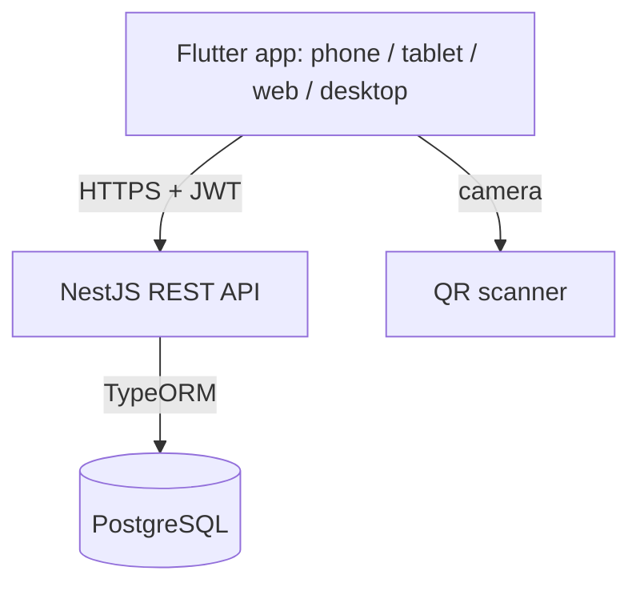

# Architecture



## Flutter app (`lib/`)

```
lib/
  main.dart, app.dart, app_routes.dart     entry point, MaterialApp, named routes
  core/
    api/        ApiConfig (base URL per platform, user-overridable), HTTP helpers
    storage/    secure/shared-preferences storage (tokens, theme, saved accounts)
    theme/      app_colors.dart (palette, status colors), app_tokens.dart (spacing, radii,
                motion, gradients, StatusColors extension), app_theme.dart (light + dark ThemeData)
    widgets/    brand_logo.dart (code-drawn logo), adaptive_shell.dart (responsive navigation),
                app_widgets.dart (AppCard, KpiCard, StatusPill, AppSearchField, PrimaryButton,
                EmptyState, ErrorState, Skeleton, FadeSlideIn, ContentWidth)
  state/        auth_state.dart, theme_state.dart (Riverpod)
  features/     splash, auth, dashboard, home, batches, requests, users, profile,
                notifications, activity, admin  (each: pages + data/ + state/ + models/)
```

- **State:** Riverpod 3. `StateProvider`/`StateNotifier` come from `flutter_riverpod/legacy.dart`.
- **Navigation:** named routes at the top level; the user dashboard keeps one nested `Navigator` per tab
  so each tab preserves its own stack. `AdaptiveShell` switches bottom bar / rail / sidebar at 700 and 1100 px.
- **Offline:** key lists (batches, requests, activity, profile) are cached and shown when the API is unreachable.
- **Design system:** always use theme tokens, not literals: `Gap.*`, `Radii.*`, `Motion.*`,
  `Theme.of(context).colorScheme`, `context.status.success/warning/danger/info`, `AppColors.statusColor(status)`.
  Do not add raw `Colors.*` or `TextStyle(color: ...)` in feature code; it breaks dark mode.
- **Brand:** the logo is `BrandMarkPainter`. `tool/gen_icons_test.dart` exports PNGs for icons and favicons.

## API (`backend/api/src`)

One Nest module per domain: `auth`, `users`, `products`, `stages`, `batches`, `batch-events`,
`ownership-requests`, `admin`. Guards: `JwtAuthGuard` (all but auth/health), `AdminGuard` (admin-only routes).
`ValidationPipe` (whitelist, forbid unknown fields) validates every DTO. ESM-only Nest 12 runs on Node 22.12+.

### Data model

| Table | Key columns |
|---|---|
| `users` | id, email (unique), password (bcrypt, never selected by default), role, name, organization, location, account_type, members (jsonb) |
| `products` | id, name |
| `stages` | id, name, sequence, active |
| `batches` | id, productId, ownerId, batchCode, quantity, unit, status, grade, stageId, qrPayload, isDisqualified, isItem, itemName |
| `batch_relations` | parent/child links for split, merge, transform (lineage) |
| `batch_events` | immutable per-batch event log (history timeline) |
| `ownership_requests` | batchId, requesterId, ownerId, quantity, status, note |

Tables are created automatically on API start in development (`synchronize`); production uses migrations in
`backend/api/src/database/migrations/`. See [DATABASE.md](DATABASE.md).

## Branching and releases

`main` is the released branch; `dev` is the integration branch. Work happens on feature branches, merged into
`dev`, then `dev` into `main`. Commit style: `feat:`, `fix:`, `chore:`, `docs:`, `test:`.
